# GregGuns

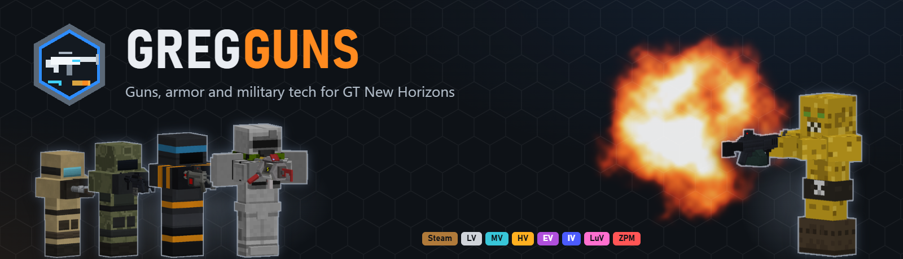

Guns, armor and military tech for [GT New Horizons](https://github.com/GTNewHorizons/GT-New-Horizons-Modpack) on Minecraft 1.7.10.

GregGuns is a from-scratch rewrite inspired by [Techguns](https://github.com/pWn3d1337/Techguns). It is not a port. GTNH has changed 1.7.10 so much that the original code would not carry over cleanly. GregGuns is written against GTNH's own APIs instead, and its weapons, components and recipes are gated by GregTech tiers rather than vanilla-style crafting.

> [!IMPORTANT]
> **Beta.** [**GregGuns 0.3.3-beta**](https://github.com/Tuxprogrammer/GregGuns/releases/tag/0.3.3-beta) is out for **GTNH 2.9.0-RC-2**. Everything planned for the first full version is in: weapons Steam to ZPM, ammo lines, armor, turrets, NPCs and ruins, an optional questbook tab, and now aim down sights, an in-game guide and structures on Ross128. It has been tested inside the real pack. Expect some rough edges, and back up your world before you add it. The [release notes](https://github.com/Tuxprogrammer/GregGuns/releases/tag/0.3.3-beta) list the known issues (one is with shader packs), and [docs/ROADMAP.md](docs/ROADMAP.md) shows what comes next.

## For players

GregGuns adds guns, ammo, armor, turrets, enemy soldiers and ruins to GTNH. It adds no tech tree of its own. Every weapon is assembled from GregTech parts on GregTech machines and unlocks at a GregTech tier: a Hand Cannon in the Steam age, a 9mm Pistol once you have Steel, assault rifles at MV, and so on up to the Nuclear Death Ray at ZPM. Ammo is a production line. You press rounds and magazines in the **Ammo Press**, or in bulk in the **Ammunition Works** multiblock.

### Install

1. Download `gregguns-0.3.3-beta.jar` from the [release page](https://github.com/Tuxprogrammer/GregGuns/releases/tag/0.3.3-beta).
2. Put it in the `mods` folder of your **GTNH 2.9.0-RC-2** instance. For multiplayer, the server **and** every player need the same jar.
3. Start the game. Every module is on by default. You can switch modules off in `config/gregguns.cfg`, and that never stops anyone joining: the server's settings apply to everyone connected.

The keys are **R** to reload, **;** for the back device (glider, anti-gravity), **M** for night vision and **]** for the ammo pouch. All of them can be rebound in Controls.

### Getting started

1. **Install** as above.
2. **Steam age.** Craft the Hand Cannon and some Stone Bullets.
3. **LV.** Assemble a 9mm Pistol from GT parts, and build an LV Ammo Press.
4. **Ammo.** Press bullets and magazines, then reload with **R**.
5. **Upkeep.** Mend worn gear on a Repair Bench or in the Armory Gantry. A **GregGuns** questbook tab leads you up the tiers once the server owner switches it on (see below).

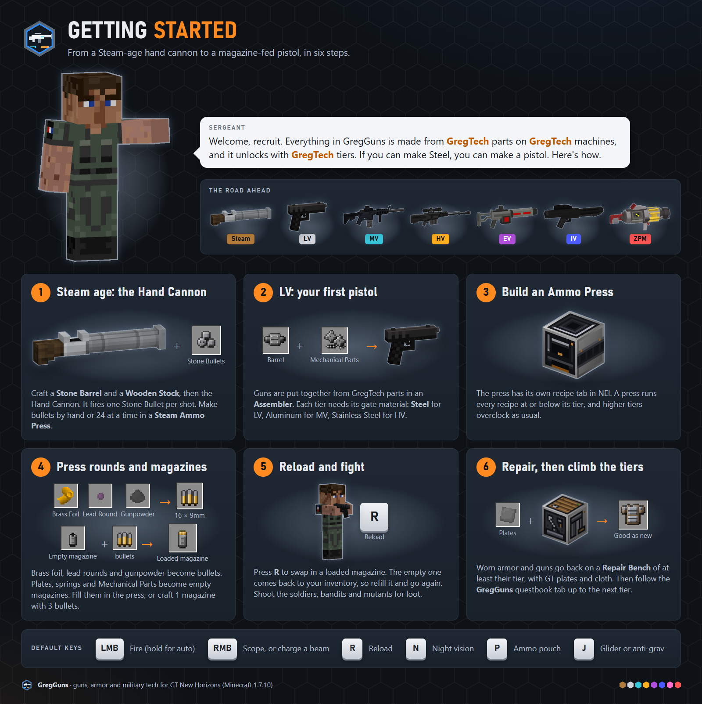

### Guides

Each guide is a single image you can share on its own.

#### The arsenal

Every weapon, Steam to ZPM.

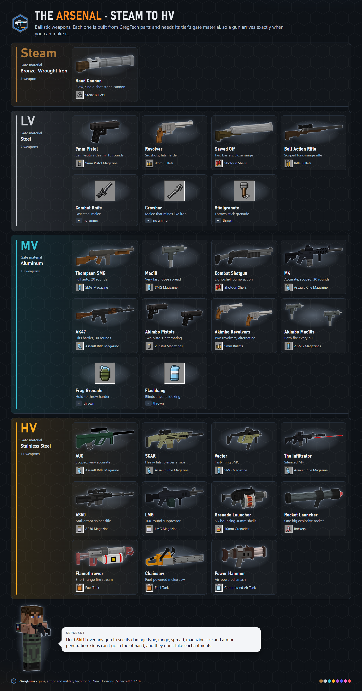

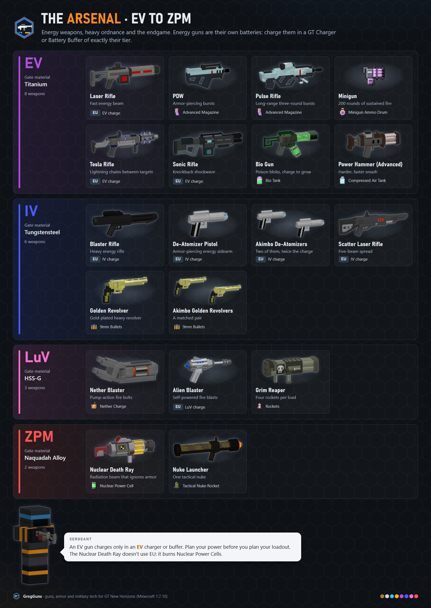

#### Recipes

The Steam and LV crafting chains.

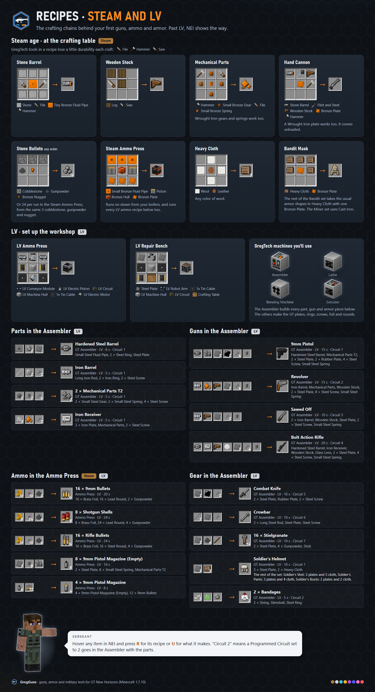

#### Ammo and magazines

From GT materials to a loaded gun.

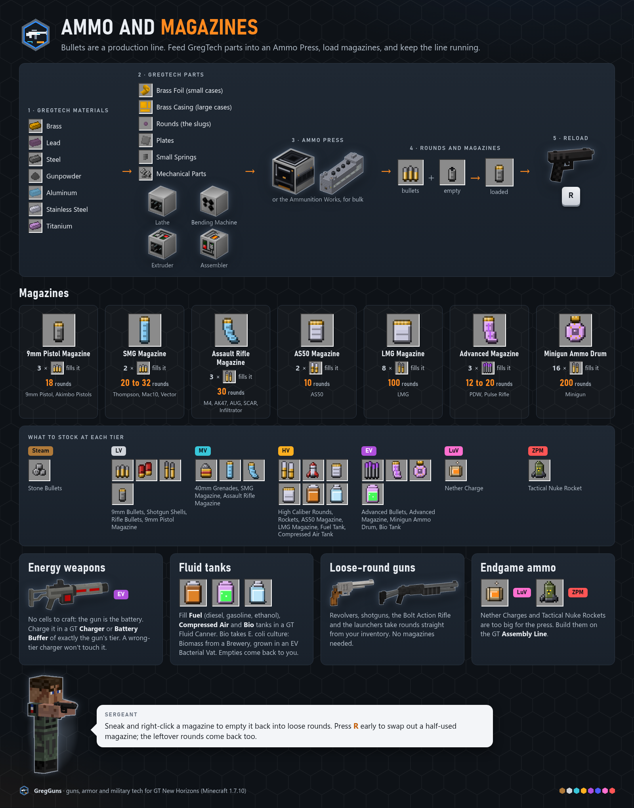

#### Armor and gear

Twelve armor sets, masks and back gear.

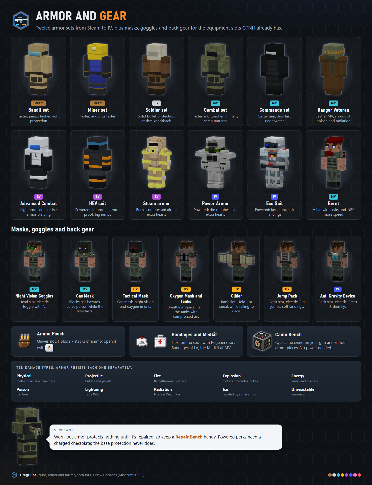

#### Machines

Each single block and its multiblock.

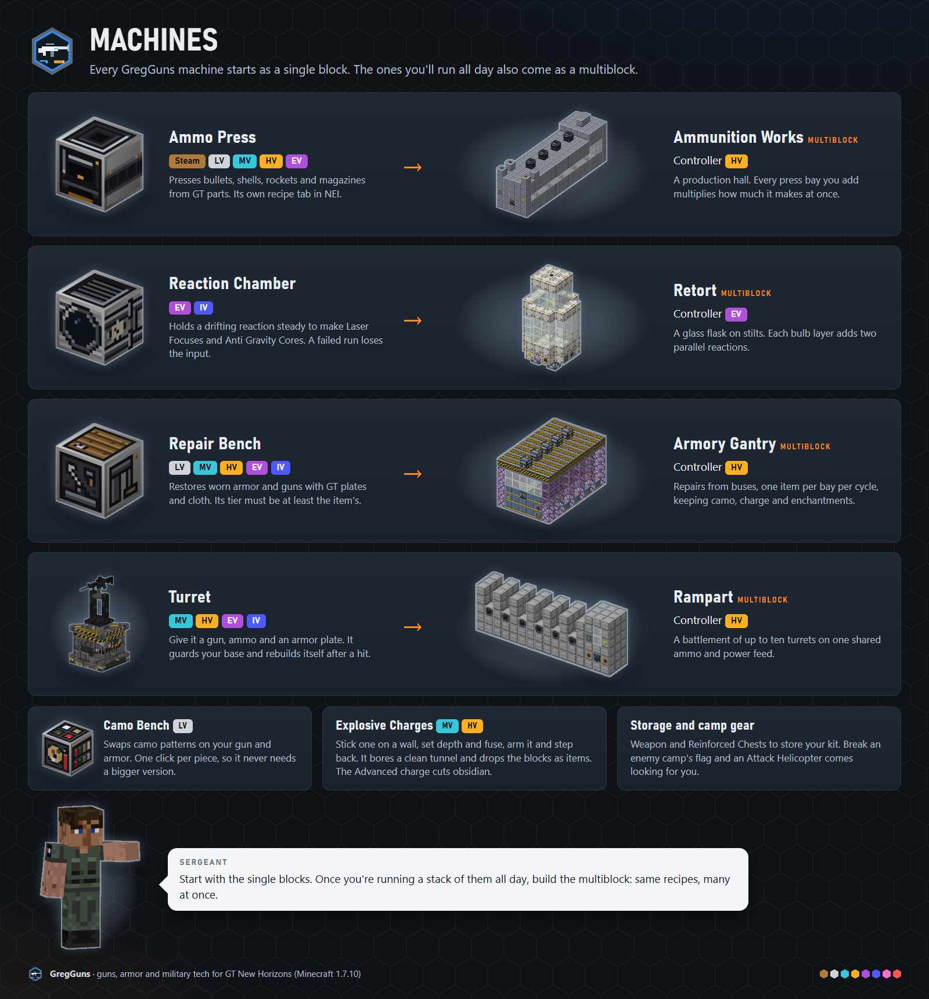

#### Multiblock build guides

Ammunition Works (with the optional Magazine Filling Bench), Armory Gantry, Rampart. Both halls need an interior lamp.

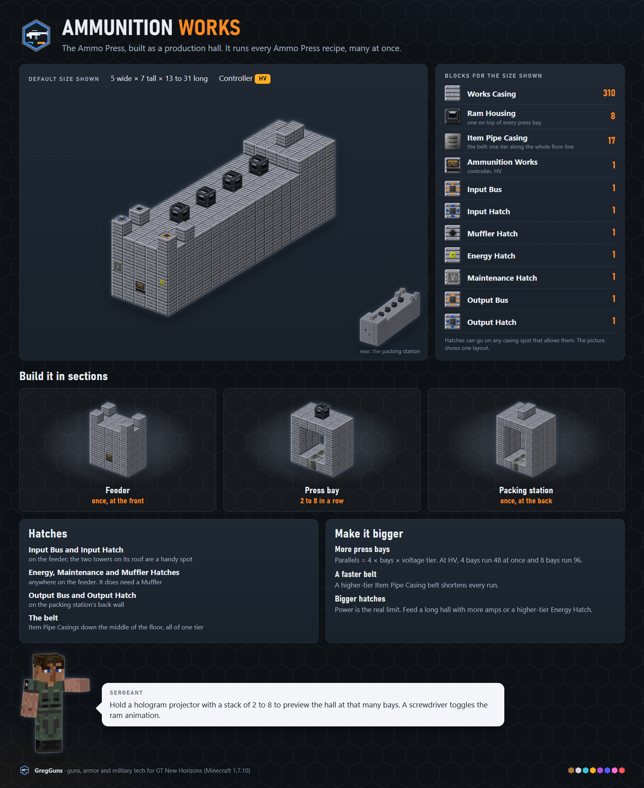

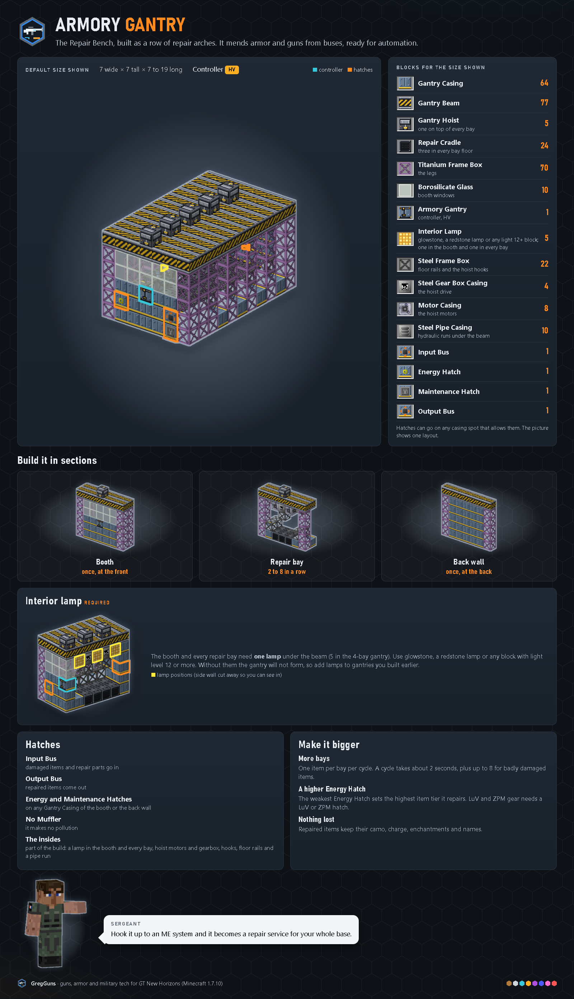

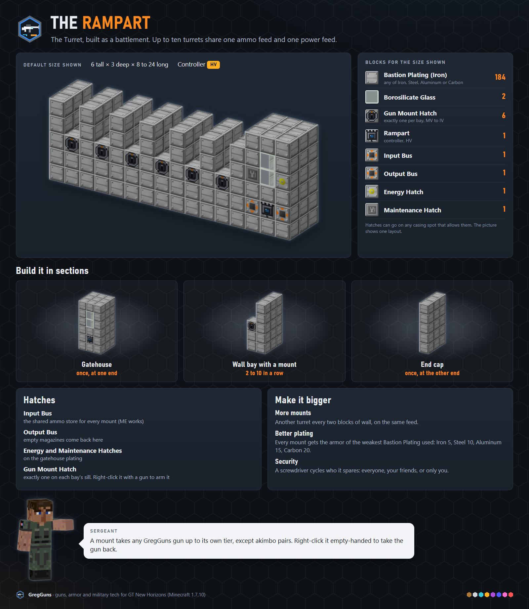

#### Enemies and loot

Who shoots back, and what they drop.

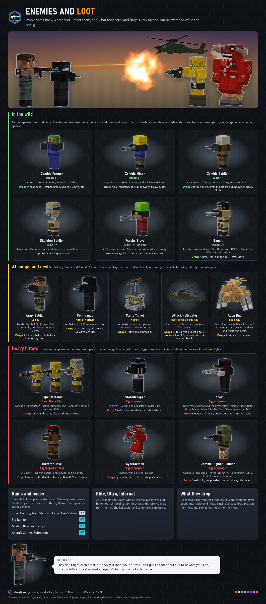

#### The questbook

Chapters, side branches and rewards. The tab ships inside the mod. A server owner switches it on with `questbook.install=true` in `config/gregguns.cfg`, then restarts the server (see [docs/config.md](docs/config.md#hidden-keys)).

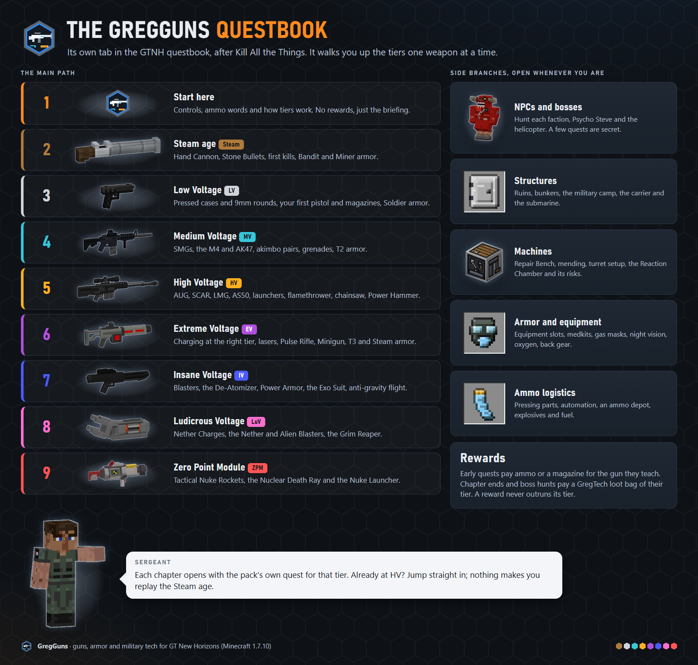

## Building

Requires JDK 25. The build compiles down to Java 8 bytecode through Jabel.

```sh
./gradlew setupDecompWorkspace   # first time only
./gradlew build                  # jar lands in build/libs/
./gradlew runClient              # dev client
./gradlew spotlessApply          # format before committing
```

Dependencies go in [`dependencies.gradle`](dependencies.gradle), extra repositories in [`repositories.gradle`](repositories.gradle), and mod/build settings in [`gradle.properties`](gradle.properties). Leave `build.gradle.kts` and `settings.gradle.kts` alone: they come from the [GTNH buildscript](https://github.com/GTNewHorizons/ExampleMod1.7.10) and are replaced wholesale on updates.

## Relationship to Techguns

Techguns is by pWn3d1337, and its repository declares no license, so all rights are reserved. GregGuns uses Techguns as a design reference only. **Do not copy Techguns code, textures, models or sounds into this repository** without explicit permission from its author.

What Techguns does is captured in a behavioral spec at [docs/techguns-spec/](docs/techguns-spec/README.md). Implement from that spec, not from the Techguns source.

## License

The GregGuns code, original art, sounds, models, documentation, specs and tools are released under the [MIT License](LICENSE). Anyone may download, use, copy, modify, merge, publish, distribute, sublicense and sell them under the terms of that license.

**Code.** Everything is MIT. A few ICBM algorithms derive from [ICBM-Classic](https://github.com/BuiltBrokenModding/ICBM-Classic) (MIT, `prod/1.12`); each ported file names its source, and [THIRD-PARTY-NOTICES.md](THIRD-PARTY-NOTICES.md) keeps the required MIT notice.

**Third-party assets in the mod jar.** The ICBM module ships art from HBM's Nuclear Tech Mod (warhead, missile and silo models, textures and item icons, the Radar Casing tiles and the fallout block art), licensed under the LGPL-3.0, with the modifications named. Each `thirdparty/ntm/` folder under `src/main/resources/assets/gregguns/` holds the license text beside the files (`LICENSE.txt` and `GPL-3.0.txt`), and [docs/assets/CREDITS.md](docs/assets/CREDITS.md) lists every file with its source commit. Those files stay under their own license; the rest of the jar is MIT.

**Third-party art in the guide sheets.** The infographics in `docs/assets/infographics/` (not part of the jar) paint in some upstream art: GregTech 5 Unofficial textures (hulls, hatches, frames, glass and material icons, LGPL-3.0), Galacticraft Legacy art (MIT), Tinkers' Construct glass (LGPL-3.0), HBM's Nuclear Tech Mod renders (LGPL-3.0) and the Minecraft textures (Mojang's usage guidelines). The Missile Silo sheet also paints in two NewHorizonsCoreMod icons under the GPL-3.0, so that sheet is GPL-3.0. Each sheet's credits row in [docs/assets/CREDITS.md](docs/assets/CREDITS.md) says which parts it uses; the license texts sit beside the source files in `tools/asset-gen/infographics/inputs/thirdparty/`. The rest of each image is MIT.

**Build files.** The Gradle wrapper (`gradlew`, `gradlew.bat`, `gradle/wrapper/`, Apache-2.0) and the GTNH buildscript files (`build.gradle.kts`, `settings.gradle.kts`, `gtnhShared/`, from [GTNewHorizons/ExampleMod1.7.10](https://github.com/GTNewHorizons/ExampleMod1.7.10)) keep their own licenses.

The MIT License covers only what is in this repository. It grants no rights to Techguns, which is not included here (see [Relationship to Techguns](#relationship-to-techguns)).
